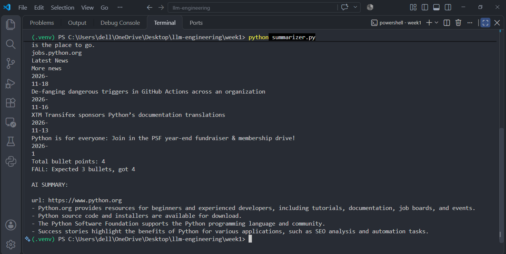
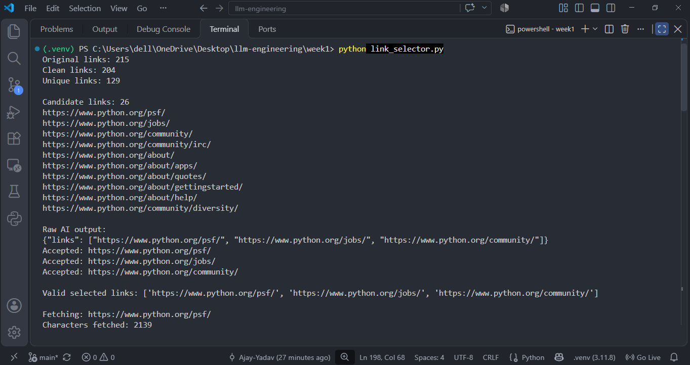
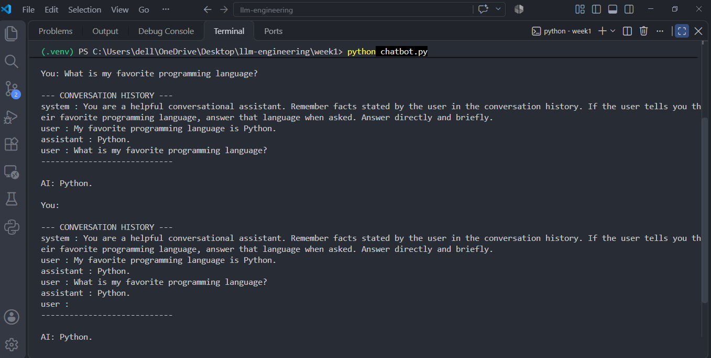

# Local LLM Engineering — Week 1 Projects

Hands-on Python projects exploring Large Language Models (LLMs), prompt engineering, web scraping, streaming, tokenization, and conversation history.

Built while learning LLM engineering concepts from Ed Donner's course, using locally hosted models with Ollama.


## Project Demos

These screenshots demonstrate the projects running locally with Ollama and Qwen.

### 1. Website Summarizer

Extracts website content and generates an AI-powered summary.



### 2. Multi-Page Company Brochure Generator

Selects relevant website pages, validates URLs, extracts content, and generates a Markdown brochure using a local LLM.



### 3. Conversation Memory Chatbot

Demonstrates how an LLM uses conversation history to answer follow-up questions.




## Tech Stack

- Python
- Ollama
- Qwen 2.5 (1.5B)
- OpenAI Python SDK (Ollama-compatible API)
- BeautifulSoup
- Requests
- tiktoken

## Projects

### 1. Website Summarizer
**Files:** `scraper.py`, `summarizer.py`

Fetches content from a website, removes unnecessary HTML elements, and generates a summary using a local LLM.

### 2. AI Technical Tutor
**File:** `ai_tutor.py`

Answers programming questions using a local LLM and streams responses to the terminal.

### 3. Multi-Page Company Brochure Generator
**Files:** `link_selector.py`, `brochure.py`, `scraper.py`

- Extracts website links.
- Filters invalid and duplicate URLs.
- Uses an LLM to select relevant pages.
- Validates selected URLs against the scraped list.
- Fetches multiple pages and combines their content.
- Generates a Markdown brochure with streaming output.
- Saves the brochure as `company_brochure.md`.

### 4. Conversation Memory Chatbot
**File:** `chatbot.py`

Maintains conversation history using system, user, and assistant messages. Supports follow-up questions within the same session.

### 5. Tokenization Experiments
**File:** `token_test.py`

Demonstrates text encoding, token IDs, token counts, and decoding with `tiktoken`.

## Getting Started

### Requirements

- Python 3.11+
- Ollama installed locally
- Qwen 2.5 1.5B model

### Installation

Clone this repository and install dependencies:

```bash
git clone https://github.com/yadav-aj/llm-engineering-projects.git
cd llm-engineering-projects

python -m venv .venv
```

Activate the virtual environment:

Windows PowerShell:

```powershell
.\.venv\Scripts\Activate.ps1
```

Install dependencies:

```bash
pip install -r requirements.txt
```

Download the local model:

```bash
ollama pull qwen2.5:1.5b
```

Ensure Ollama is running, then run a project:

```bash
python summarizer.py
python ai_tutor.py
python link_selector.py
python chatbot.py
python token_test.py
```

## What I Learned

- Integrating local LLMs through an OpenAI-compatible API
- Designing system and user prompts
- Parsing and validating JSON responses
- Handling hallucinated URLs
- Web scraping with BeautifulSoup
- Streaming model responses
- Managing conversation history
- Understanding tokenization and token IDs

## Limitations

- Small local models may generate inaccurate information.
- Link validation does not guarantee factual accuracy.
- Chatbot history is stored in memory and resets when the program exits.
- Website scraping depends on page structure and availability.
- These are learning prototypes, not production-ready applications.

## Future Improvements

- Automated factual verification
- Better error handling and retry strategies
- Persistent conversation history
- Automated tests and evaluation
- Support for multiple models

## Acknowledgement

Inspired by Ed Donner's LLM Engineering course. The implementations include personal exercises, modifications, and experiments using local models.
